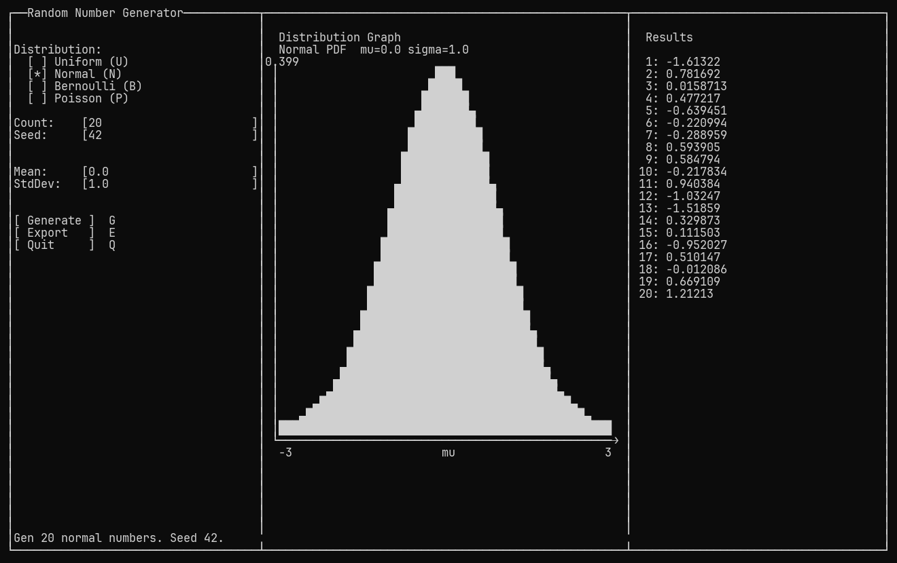

# Random Number Generator (RNG)

An interactive terminal-based random number generator written in C.
Zero external dependencies — ANSI escape codes plus the C standard library;
Windows renders via the Win32 console API, with no ANSI/VT involved.
On Windows 10/11 every console host works out of the box; on Windows 7/8,
run it inside a terminal emulator such as ConEmu or Cmder.

## Screenshot



## Features

- Three-column TUI layout: controls | graph | results
- Uniform distribution: random integers in [min, max]
- Normal distribution: Box-Muller transform with configurable mean/stddev
- Bernoulli distribution: 0/1 outcomes with configurable probability p
- Poisson distribution: Knuth's algorithm with configurable rate λ
- Real-time graphs of the probability density / mass functions, drawn with
  Unicode block elements (█, ▀, ▄) and box-drawing axes, so curves and bars
  come out solid and smooth instead of stair-stepped
- Export results to CSV with timestamp filenames
- Reproducible results: set a fixed Seed (0 = auto, uses current time)

### Graph rendering

The plot is a half-block canvas: every character cell holds two vertically
stacked half-cells, rendered with `█` (full block), `▀` (upper half) and `▄`
(lower half). That gives a 1x2 sub-cell grid — twice the vertical resolution of
plain `#` art — while keeping the fill solid instead of dotted. Axes use
box-drawing characters (`│`, `─`, `└`, `→`) and the frame uses the
`┌ ┬ ┐ ├ ┤ └ ┴ ┘` family; labels and the value readout stay ASCII.

This needs a font that covers the Block Elements and Box Drawing ranges — most
monospace fonts do. Where UTF-8 cannot reach the screen, the graph degrades to
one `#` per touched cell and the frame to ASCII `+ - |`: on Windows the console
output code page is switched to UTF-8 for the session, and if that is refused,
the ASCII fallback is used.

## Build

```bash
gcc -Wall -Wextra -std=c99 -pedantic -Isrc -o rng-tui \
    src/tui.c src/term.c src/controls.c src/random.c \
    src/stats.c src/output.c \
    src/graph/graph.c src/graph/block.c src/graph/graph_uniform.c \
    src/graph/graph_normal.c src/graph/graph_bernoulli.c \
    src/graph/graph_poisson.c -lm
```

> Or `cmake` if you have it installed (uses the included CMakeLists.txt).

## Usage

```bash
./rng-tui
```

### Key Bindings

| Key            | Action                           |
| -------------- | -------------------------------- |
| `G`            | Generate random numbers          |
| `E`            | Export results to CSV            |
| `U`            | Switch to uniform distribution   |
| `N`            | Switch to normal distribution    |
| `B`            | Switch to Bernoulli distribution |
| `P`            | Switch to Poisson distribution  |
| `Tab`          | Cycle focus between input fields |
| `Up` `Down`    | Scroll results                   |
| `Left` `Right` | Move cursor in input fields      |
| `Backspace`    | Delete character in input field  |
| `Q` / `Esc`    | Quit                             |

### Parameter Fields

| Field          | Meaning                                                        |
| -------------- | -------------------------------------------------------------- |
| Count          | How many numbers to generate (1–1000)                          |
| Seed           | 0 = auto (time-based); non-zero = fixed, sequence reproducible |
| Min / Max      | Uniform range `[min, max]`                                     |
| Mean / StdDev  | Normal mean and standard deviation                             |
| Prob           | Bernoulli probability p in [0, 1]                              |
| Lambda         | Poisson rate λ                                                 |

> Reproducibility: the same Seed with the same distribution, parameters,
> and Count yields the identical sequence on every run and platform.

## Project Structure

```
src/
├── tui.c/h                     Main event loop, frame rendering, results panel
├── term.c/h                    Terminal control (Win32 console API on Windows, ANSI elsewhere) + keyboard input
├── chars.h                     UTF-8 glyph constants for blocks and box drawing
├── controls.c/h                Left panel: parameter fields, field editing
├── random.c/h                  Random number generation (xoshiro256** + SplitMix64)
├── stats.c/h                   Statistics (min, max, mean, stddev)
├── output.c/h                  Output to console / CSV file
└── graph/
    ├── graph.c/h               Graph area dispatch (clear + route)
    ├── graph_axes.h            Shared box-drawing axis renderer
    ├── block.c/h               Half-block canvas used by the graphs
    ├── graph_uniform.c/h       Uniform distribution PDF graph
    ├── graph_normal.c/h        Normal distribution PDF bell curve
    ├── graph_bernoulli.c/h     Bernoulli distribution PMF dual-bar
    └── graph_poisson.c/h       Poisson distribution PMF bar chart
```

## Platform Notes

- **Windows 10 / 11** (cmd.exe, Windows Terminal, ConEmu, other console
  hosts): renders exclusively through the Win32 console API — one code path,
  no ANSI/VT involved, no terminal emulator needed.
- **Windows 7 / 8**: the native console window (cmd.exe's conhost) has
  rendering problems with full-screen TUIs (viewport scrolling / ghost rows),
  so run rng-tui inside a terminal emulator instead. ConEmu or Cmder are
  recommended — both are free and support Windows 7 (Windows Terminal
  requires Windows 10, so it is not available there). Any terminal host that
  handles the Win32 console API correctly will do.
- **Non-Windows** (Linux/macOS): ANSI escape codes as usual.

## License

MIT
